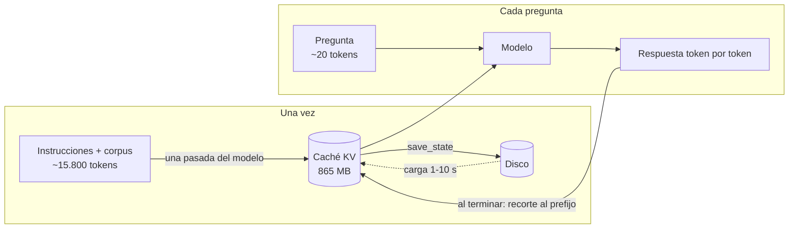
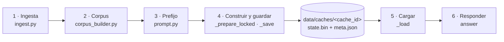
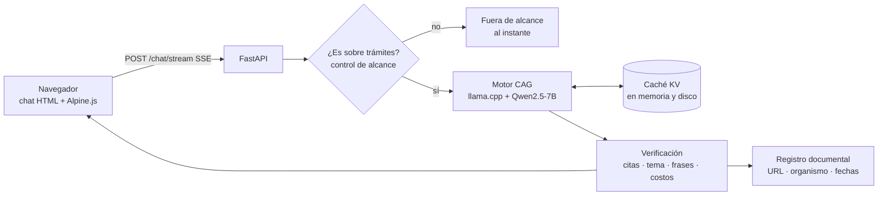
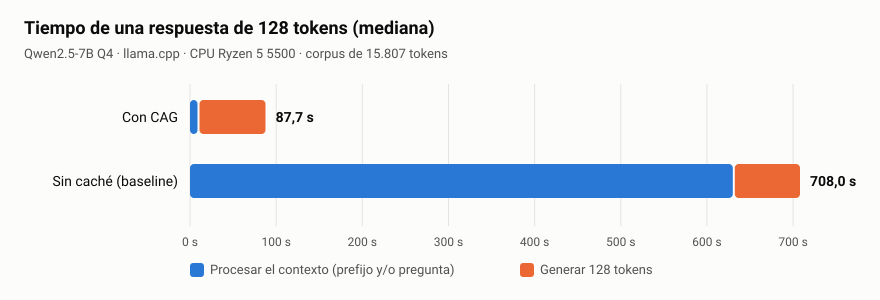
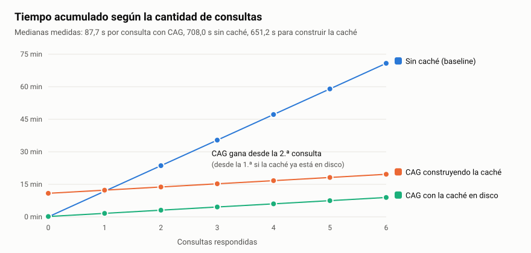

# Material técnico de la exposición

Material común a las dos versiones de la exposición ([dinámica](version_A_dinamica.md) y
[por bloques](version_B_bloques.md)). Todas las cifras salen de las mediciones reales del
proyecto, registradas en [`PROGRESS.md`](../../PROGRESS.md) y en `data/results/`.

## 1. Datos clave para tener a mano

| Dato | Valor | Fuente |
|---|---|---|
| Documentos del corpus | 12 documentos oficiales, 82 secciones | Fase 2 (`build_id 10ba192df05e0285`) |
| Tamaño del prefijo | ~15.800 tokens (instrucciones + corpus + reglas y ejemplos) | Fase 6 |
| Modelo | Qwen2.5-7B-Instruct cuantizado a 4 bits (Q4_K_M), con llama.cpp | Fase 5 (revisión 5.1) |
| Equipo | Ryzen 5 5500, 16 GB de RAM, **sin GPU** | Fase 6 |
| Caché KV del corpus | 865 MB (56 KB por token) | Fase 6 |
| Construir la caché (una vez) | 651 s (~11 minutos) | Fase 6 |
| Cargarla desde disco | 9,6 s en frío, 1,3 s en caliente | Fase 6 |
| **Primer texto con CAG** | **8,8 s** (mediana de 29 mediciones, p10–p90: 7,5–9,3) | Fase 6 |
| **Primer texto sin caché** | **630 s** (10,5 min; n = 6) | Fase 6 |
| Respuesta de 128 tokens | CAG 87,7 s · sin caché 708 s (8,1 veces) | Fase 6 |
| Generación por token | 0,62 s en los dos modos: CAG no acelera la generación | Fase 6 |
| CAG = sin caché, token por token | 6 de 6 respuestas idénticas | Fase 6 |
| Punto de equilibrio | Desde la 2.ª consulta (desde la 1.ª si la caché está en disco) | Fase 6 |
| Preguntas sin respuesta en el corpus | 12 de 12 sin información inventada en las tres evaluaciones | Fases 5 y 6 |
| Preguntas nuevas, respondibles | 6 de 7 mostradas y correctas (la 7.ª se ocultó con razón) | Fase 6, rev. 6.1 |

## 2. Qué es CAG (verificado en las fuentes)

**Paper:** Chan, Chen, Cheng y Huang, *Don't Do RAG: When Cache-Augmented Generation is All You
Need for Knowledge Tasks* (arXiv 2412.15605, dic. 2024, rev. feb. 2025). Describe tres fases:

1. **Precarga:** los documentos se codifican **una vez** en una caché clave-valor (KV). El costo
   de procesarlos se paga una sola vez, sin importar cuántas consultas vengan después.
2. **Inferencia:** la caché se carga junto con la pregunta y el modelo responde sin un paso de
   recuperación.
3. **Reinicio:** la caché crece al agregar la pregunta y la respuesta; se reinicia **truncando
   esos tokens nuevos**, sin volver a cargar todo.

El repositorio de referencia (`hhhuang/CAG`) lo implementa con Transformers: construye un
`DynamicCache` con una pasada sobre los documentos y, antes de cada pregunta, `clean_up()`
recorta las K/V de cada capa al largo original. En el paper (Llama 3.1 8B, SQuAD y HotPotQA),
CAG iguala o supera a RAG en la mayoría de los casos, **pero la ventaja se achica a medida que
crece el corpus**. Es un matiz honesto para contar.

## 3. Atención y caché KV, en simple

- Cada token, en cada capa, produce tres vectores: **Query** (qué busco), **Key** (qué ofrezco
  para que me encuentren) y **Value** (qué información aporto).
- Un token nuevo compara su Query con las Keys de todos los tokens anteriores y mezcla sus Values.
- En un modelo causal, **las K/V de un token dependen solo de él y de los anteriores**: las del
  corpus son siempre las mismas, venga la pregunta que venga. Por eso se pueden calcular una vez
  y guardar.
- **Analogía para la clase:** leer el libro una vez y quedarse con los apuntes. Para cada pregunta
  se consultan los apuntes, sin releer el libro. Lo que no se ahorra es escribir la respuesta.
- **Tamaño:** 2 (K y V) × 28 capas × 4 cabezas K/V × 128 dimensiones × 2 bytes ≈ 56 KB por token.
  Qwen usa *Grouped-Query Attention* (pocas cabezas K/V compartidas), y por eso los ~15.800 tokens
  del corpus ocupan 865 MB y no varios GB.



## 4. Diferencias de la §8

| Concepto | Qué guarda | Qué ahorra | En TramitaIA |
|---|---|---|---|
| **Caché KV (CAG)** | Las K/V de atención del corpus, calculadas por el modelo | Volver a procesar el corpus en cada pregunta | Sí: es el centro del proyecto |
| **Prompt caching** (APIs) | Lo mismo, pero en el servidor del proveedor y con vencimiento (5 min a 1 h) | Costo y tiempo del prefijo repetido | No (se analizó como referencia en la Fase 6) |
| **Caché de respuestas** | Pregunta → respuesta ya generada | Todo, pero solo si la pregunta se repite igual | No: no sería CAG |
| **Almacenamiento de documentos** | Los textos originales y sus metadatos | Volver a descargar | Sí: `data/raw`, `data/processed`, manifiesto |
| **Índice vectorial** | Embeddings de fragmentos | Buscar fragmentos parecidos | No |
| **RAG** | Índice + recuperación de *k* fragmentos por pregunta | Meter todo el corpus en el contexto | No: se compara en teoría |

## 4 bis. El código de punta a punta (versión B: Ramiro muestra 1 y 2, Nelson de 3 a 6)



**1. Ingesta** (`app/ingestion/`): de la página oficial a un texto versionado.

```python
result = downloader.fetch(spec.source_url)      # respeta robots.txt y espera 2 s entre pedidos
parser = get_parser(spec.parser)                # uno por sitio: registro_civil, justicia_spa, argentina_gob, pdf
parsed = parser(result.content, result.encoding, spec.source_url)   # los <h2> pasan a "## "
record.raw_hash = sha256_bytes(result.content)  # ¿cambió el original?
record.content_hash = sha256_text(parsed.text)  # ¿cambió el texto extraído?
change = manifest.upsert(record)                # new | updated | reparsed | unchanged
# con versión nueva: data/raw/<doc>/vN.html y data/processed/<doc>/vN.txt
```

- `reparsed` = mismo original pero cambió la extracción (un cambio nuestro, no del organismo).
- Si una descarga falla, **se conserva la versión anterior** (`failed_kept_previous`) y se anota
  el error.

**2. Corpus** (`app/ingestion/corpus_builder.py`): del texto a secciones citables.

```python
starts = [m.start() for m in re.finditer(r"(?m)^## ", text)]   # split_markdown: corta en cada "## "
Section(f"{doc_id}#s{len(sections)}", heading, chunk, start, end)  # rc-nacimientos#s2
```

`_render_block` arma cada documento así (texto real del corpus):

```text
<<<DOCUMENTO id=rc-nacimientos>>>
Título: Inscripción de Nacimientos
Organismo: Registro Civil de La Rioja
Fuente oficial: https://registrocivil.larioja.gob.ar/tramite-nacimientos.html
Última actualización publicada por el organismo: 2025-10-20
[rc-nacimientos#s2] Documentación requerida
*Certificado médico de nacimiento original con sello del profesional firmante ...
```

El `build_id` es un hash del texto, del tokenizer y de la configuración: si cambia cualquiera, es
otro corpus.

**3. Prefijo** (`app/cag/prompt.py`): qué entra en la caché y qué no.

```python
system = SYSTEM_INSTRUCTIONS + corpus_text + SYSTEM_CLOSING      # reglas antes y después del corpus
prefijo = "<|im_start|>system\n" + system + "<|im_end|>\n"         # ~15.800 tokens: se cachea
pregunta = "<|im_start|>user\n" + q + "<|im_end|>\n<|im_start|>assistant\n"   # ~20 tokens: por consulta
```

**4. Construir y guardar la caché** (`LlamaCppEngine._prepare_locked` y `_save`).

```python
try:
    self.state = self._load()                 # ¿hay una caché válida en disco?
except CacheValidationError:                  # no, o no coincide: construirla
    self.llm.reset()
    self.llm.eval(prefix_ids)                 # UNA pasada por ~15.800 tokens (~11 min en CPU)
    fp, kv_bytes = self.fingerprint()         # SHA-256 de las K/V
    state = self.llm.save_state()
    (tmp / "state.bin").write_bytes(state.llama_state)   # ~868 MB
    (tmp / "meta.json").write_text(json.dumps(meta))      # modelo, prefijo, huella, n_ctx...
    tmp.rename(final)                         # carpeta temporal: nunca queda una caché a medias
```

`cache_id = sha256([modelo, revisión, cuantización, hash del prefijo])[:16]` → la carpeta
`data/caches/bda0d01871987281/`. Si cambia el modelo, el prompt o el corpus, cambia el id.

**5. Cargarla desde disco** (`LlamaCppEngine._load`): 1,3 a 9,6 s en vez de 11 minutos.

```python
meta = json.loads((directory / "meta.json").read_text())
for clave in ("model_id", "revision", "dtype", "prefix_len", "prefix_hash", "n_ctx", "model_bytes"):
    if meta[clave] != esperado[clave]: raise CacheValidationError(...)
if meta["corpus_version"] != corpus_actual: raise CacheValidationError("caché desactualizada")
self.llm.load_state(LlamaState(llama_state=(directory / "state.bin").read_bytes(), n_tokens=self.prefix_len, ...))
if self.fingerprint()[0] != meta["fingerprint"]:
    raise CacheValidationError("archivo alterado o corrupto")    # → se reconstruye
```

**6. Responder:** ver la sección 5.

## 5. El código central: `LlamaCppEngine.answer()` (`app/cag/llamacpp_engine.py`)

```python
ids = self.validate_question(question, max_new_tokens)      # 1. ¿pregunta válida y entra en el contexto?
with self._lock:                                            # 2. una consulta por vez: la caché es una sola
    self._reset_to_prefix()                                 # 3. volver al estado base: solo el corpus
    self._verify_base_state()                               # 4. huella SHA-256: ¿son las K/V originales?
    ...                                                     #    (si no: recuperar desde disco)
    try:
        self.llm.eval(ids)                                  # 5. procesar SOLO la pregunta (~20 tokens)
        for i in range(new_tokens):                         # 6. generar token por token (greedy)
            token = int(np.argmax(self._last_logits()))
            if token in self.stop: break
            self.llm.eval([token])                          #    cada token nuevo atiende sobre toda la caché
    finally:
        self._reset_to_prefix()                             # 7. limpiar SIEMPRE, aunque algo falle
```

`_reset_to_prefix()` es el «reinicio» del paper. En llama.cpp, `eval()` borra de la caché todo lo
que está después de `n_tokens`, así que alcanza con volver `n_tokens` al largo del prefijo:

```python
self.llm.n_tokens = self.prefix_len
self.llm.eval([])          # eval borra de la caché todo lo posterior a n_tokens
```

Con Transformers (Fases 3 y 4) es `DynamicCache.crop(-n)`. Ojo: en Transformers 5 recibe la
cantidad a **quitar**, en negativo; un tutorial viejo con `crop(largo)` falla.

**Cómo se demostró que es correcto:**
- **CAG = sin caché:** la misma pregunta, procesando todo desde cero, da exactamente los mismos
  tokens (6 de 6 con el 7B; también en las Fases 3 y 4).
- **Control negativo:** si no se limpia la caché, la segunda pregunta arranca con 117 posiciones de
  más (las de la anterior) y sus logits cambian. El código lo detecta con la huella.
- **Caché desde disco:** la huella SHA-256 se recalcula al cargarla; si se altera un solo byte, se
  rechaza y se reconstruye.

## 6. Arquitectura de la aplicación



## 7. Cómo se evita que invente

| Capa | Qué hace | Caso real que frenó |
|---|---|---|
| Control de alcance | Si la pregunta no tiene palabras de trámites, no llega al modelo | «¿Cómo hago un ciclo for en Python?» |
| Citas desde el registro | El modelo solo escribe `[doc#sN]`; URL, organismo y fechas salen del manifiesto | Trámites inventados (licencia, monotributo, antecedentes) con citas falsas |
| Filtro de tema y de trámite | Una cita a una sección de otro trámite se descarta | Monotributo «respaldado» con una sección de nacimientos |
| Verificación de frases | La mayoría de las frases tiene que estar casi textual en las secciones citadas | Requisitos de unión convivencial bajo el título «partidas» |
| Verificación de costos | Toda afirmación de costo se coteja con la sección de costo | «Costo: gratuito» cuando el documento no publica costos |
| Abstención | Frase fija cuando no hay información; se ocultan las respuestas sin respaldo | Antecedentes penales, licencia, monotributo, domicilio |

**Límite honesto:** la verificación es por coincidencia de palabras, no de significado. Puede
ocultar una respuesta correcta escrita con otras palabras, y no reemplaza leer la fuente oficial.

## 8. El camino de los modelos (lo que salió mal)

| Intento | Qué pasó |
|---|---|
| Qwen2.5-7B en PyTorch | No entra en 16 GB de RAM (15,2 GB solo de pesos) |
| Qwen2.5-3B en bf16 | La CPU no tiene bf16 nativo: entre 1 y 2,5 h para la demo |
| **Qwen2.5-1.5B en fp32** | Funciona y CAG se verifica, pero cita 1 de 8 preguntas e inventa trámites (los frenó el código) |
| Llama 3.2 3B, Qwen 3B y 7B en Q4 con llama.cpp | CAG verificable también con llama.cpp; **el 7B es el mejor** |
| **Qwen2.5-7B Q4 con llama.cpp** | El de la app: se abstiene solo y cita bien la mayoría de las respuestas |

**Lección:** CAG resuelve el costo de tener todo el corpus disponible, no la capacidad del modelo
para usarlo. Un modelo chico se pierde en un contexto de 15.800 tokens.

## 9. Gráficos

- 
- 

Se regeneran con `python -X utf8 -m app.evaluation.charts data/results/phase6_benchmark_20261017_211141.json`.
